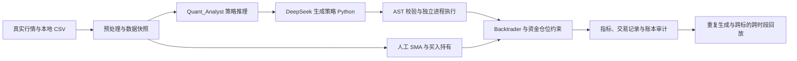

# Finrobot_MFM5110FinalProject_V2

版本：**V2**。基于 [组员 1 分享的 V1](https://github.com/yjt2003/Finrobot_MFM5110FinalProject) 补充开发与实验，供组内继续开发。V2 已完成真实数据、LLM 代码生成、传统方法对照，以及 3 个标的 × 3 个时段的通用性验证；范围与遗留项见下文。

分享入口：[GitHub 公开仓库](https://github.com/ohayoo335/Finrobot_MFM5110FinalProject_V2)。可直接访问，从仓库的 Code 菜单下载 ZIP 或使用 Git 克隆，无需协作者权限。本仓库不分发真实 API Key。

版本来源、进度和交接见 [项目状态](PROJECT_STATUS.md)，开发步骤见 [补全计划](COMPLETION_PLAN.md)，环境与验证范围见 [环境状态](ENVIRONMENT_STATUS.md)。本轮只处理开发、实验和复现交接。

## 交互使用（本次 V2 更新）

在现有 `Quant_Analyst` 对话入口中，已接入按用户指定股票、日期、均线参数、资金和开仓预算建立实验、生成执行代码及独立风险检查的能力。本次更新包含这些交互工具及验证脚本。

```powershell
.\run_finrobot.cmd --role Quant_Analyst
```

进入 `你 >` 后，可以连续输入：

```text
回测000651在2023-2024年的10/30均线，本金10万，开仓预算60%，比较买入持有并检查风险。
继续生成并运行同规则的Python代码，再检查生成策略的风险。
现在换成600031，2025年，20/60均线，开仓预算50%，重新比较并解释结果。
```

默认终端只显示“正在分析”、本轮最终分析和分析文件位置。工具参数、原始 JSON、执行进度及框架警告写入同目录的 `.log`，完整会话保存在 `.json`，可直接阅读的最终分析另存为 `.md`。Quant_Analyst 的记录位于 `artifacts/quant_dialogue/chats/`，其他角色位于 `artifacts/agent_chats/`，均不随分享包上传。

需要排查问题时显式开启调试输出：

```powershell
.\run_finrobot.cmd --role Quant_Analyst --verbose
```

本次修复了 AutoGen 历史中最终答复的角色识别问题，防止把用户提问或上一轮文本当成分析。模型未完成或请求失败时会明确显示失败与日志位置，不输出旧轮次作为结果。修改后须退出旧会话，再重新启动命令。

角色会实际调用 `prepare_quant_experiment`、`compare_quant_strategies`、`execute_quant_code` 和 `check_quant_risk`。每个实验使用独立 ID，改标的、日期或参数不会覆盖原 V2 实验。已保存的行情只有在代码、复权、覆盖范围及历史预热满足要求且哈希正确时才复用，否则通过原数据层取真实行情。

结果在 `artifacts/quant_dialogue/<experiment_id>/`，包含图表、指标、交易、风险检查、生成代码及失败记录；每轮对话也保存到 `artifacts/quant_dialogue/chats/`。这些交互数据与聊天记录默认被 Git 忽略，不自动公开。

当前交互支持参数化 SMA 与 buy-and-hold 对照。生成代码仍需遵守已验证的 SMA 接口，任意新策略或自动择优尚未实现。`max_position` 表示开仓预算比例，独立风险检查会报告实际持仓权重的漂移，不能当成持续硬性仓位上限。

离线测试：`.\.venv\Scripts\python.exe -m unittest discover -s tests -v`。完整复验还会检查交互工具链：

```powershell
# 使用保存的数据和已有模型代码检查工具链，不发出模型请求，不需要 Key
.\.venv\Scripts\python.exe scripts/validate_quant_dialogue.py --offline
# 实际执行三轮模型对话，会产生 API 用量，需要自己配置 Key
.\.venv\Scripts\python.exe scripts/validate_quant_dialogue.py --online
```

此前真实三轮对话的脱敏核对摘要见 `artifacts/quant_v2/dialogue_online_validation.json`；个人聊天记录和临时交互实验仍留在本地，不随包上传。

## 快速开始：环境与依赖

已验证环境为 **Windows x64、Python 3.11.16、CPU**，无需独立显卡。项目要求 Python 3.10–3.11，V2 推荐使用已验证的 3.11；Python 3.13 不适用。其他操作系统的完整安装尚未验证，Windows 锁定文件含平台专用依赖。

| 主要依赖 | 验证版本 | 用途 |
| --- | --- | --- |
| pyautogen | 0.2.35 | Agent、工具调用和模型接口 |
| openai / httpx | 1.55.3 / 0.27.2 | 调用 OpenAI 兼容接口 |
| numpy / pandas | 1.26.4 / 2.0.3 | 数据处理与指标计算 |
| backtrader | 1.9.78.123 | 回测执行 |
| akshare | 1.20.7 | 真实 A 股行情 |
| matplotlib | 见锁定文件 | 实验图表 |
| torch / onnxruntime | 2.5.1 CPU / 1.19.2 | 上游 PDF/RAG 依赖的 Windows 兼容版本 |

完整版本见 [requirements-windows-py311.lock.txt](requirements-windows-py311.lock.txt)，主动兼容限制见 [constraints-windows-py311.txt](constraints-windows-py311.txt)。上游 PDF/RAG 依赖也保留在环境中，首次安装会下载较大的包，耗时取决于网络。

下载或解压项目后，在包含 `setup.py` 的根目录打开 PowerShell。已安装 Python 3.11 时，可直接使用自带 venv 和 pip：

```powershell
py -3.11 -m venv .venv
.\.venv\Scripts\python.exe -m pip install -r requirements-windows-py311.lock.txt
.\.venv\Scripts\python.exe -m pip install --no-deps --no-build-isolation -e .
.\.venv\Scripts\python.exe -c "import nltk; nltk.download('punkt', download_dir='.cache/nltk_data'); nltk.download('averaged_perceptron_tagger', download_dir='.cache/nltk_data')"
.\.venv\Scripts\python.exe -m pip check
```

本机实际使用 uv 从同一锁定文件安装；已安装 uv 时，也可用后文的 uv 命令。安装依赖和首次下载 NLTK 数据需要联网，分享包不包含 `.venv`、缓存或真实 API Key。

## 架构与代码位置



| 位置 | 作用 |
| --- | --- |
| `finrobot_autogen/finrobot/data_source/` | A 股数据获取与来源路由 |
| `finrobot_autogen/finrobot/functional/quant_tools.py` | 数据清洗、保存和 Agent 工具 |
| `finrobot_autogen/finrobot/functional/quant_dialogue.py` | 交互工具：参数化实验、对比、独立风险检查及代码执行 |
| `finrobot_autogen/finrobot/functional/quantitative.py` | 回测、费用、资金约束、绩效和账本审计 |
| `finrobot_autogen/finrobot/functional/strategy_codegen.py` | 生成代码的语法、规则及因果性检查 |
| `finrobot_autogen/finrobot/agents/prompts.py` | 实际使用的量化提示词模板 |
| `finrobot_autogen/finrobot/agents/agent_library.py` | 角色与工具注册，V2 新增 `Quant_Analyst` |
| `finrobot_autogen/experiments/` | 固定案例与多标的、多时段实验入口及配置 |
| `data/` / `artifacts/` / `tests/` | 真实数据快照、完整实验产物与测试 |

风险约束在回测与代码校验中执行，交互入口另提供 `check_quant_risk` 独立查询和账本审计。AST 限制和进程超时用于约束该固定生成任务，不等同于通用操作系统沙箱。

## V2 实验与复现

首轮案例：`000001`、2021–2025 年、1,212 条真实日线、20/60 日均线；配置见 `finrobot_autogen/experiments/quant_v2_config.json`。该选择用于固定规则的实现与重复性检查，课题没有要求固定小样本。

环境配置完成后，在根目录运行：

```powershell
# 使用保存的数据和模型输出，重新计算传统对照与评估；不产生新的 API 请求
.\run_quant_v2.cmd all --resume
# 在独立进程中重新执行保存的 5 份代码；不调用 API
.\run_quant_v2.cmd verify
# 单元测试、依赖、代码重跑及断点续跑的完整复验
.\.venv\Scripts\python.exe scripts/validate_v2.py
# 多标的、多时段验证：读取已保存的真实数据，无需 API Key
.\run_generalization.cmd evaluate --resume
# 交互查看数据和执行传统回测；此项需要配置本地 DeepSeek Key
.\run_finrobot.cmd --role Quant_Analyst
```

新建 Python 3.11 环境的完整复验本机约 132 秒，`all --resume` 约 11 秒，包含解释器导入开销。初次重建环境还需完成下方依赖安装和 NLTK 数据下载。

上述 132 秒为首轮 17 项测试版本的历史测量；交互工具链版本扩展为 29 项，本次控制台修复后共有 37 项测试。控制台实测摘要见 `artifacts/quant_v2/console_output_validation.json`，此前完整流水线时间保留在 `artifacts/quant_v2/validation_summary.json`，均非对其他机器的耗时保证。

### 多标的、多时段验证

配置见 [generalization_config.json](finrobot_autogen/experiments/generalization_config.json)：

- 标的：`000001`、`000651`、`600031`。
- 三个不重叠时段：2021–2022、2023–2024、2025；每个时段重新使用相同初始资金与费用假设。
- 获取 2020–2025 年行情，为每段评价提供此前 60 条观测预热；预热期不交易、不计入绩效，第一评价日收盘形成首个可执行信号。
- 冻结原来 5 份模型代码，共 9 个标的/时段案例、45 次代码回放，全部与人工同规则结果一致；这些不是 45 次新的独立模型生成，也没有新增 LLM 请求。

```powershell
# 用随包数据复现验证结果
.\run_generalization.cmd evaluate --resume
# 从接口获取缺失的数据，再运行；已有快照只核对哈希，不重复下载
.\run_generalization.cmd all --resume
# 使用自定义标的和时段配置；新输入生成独立结果目录
.\run_generalization.cmd all --config path\to\my_config.json --resume
```

结果入口为 [latest.json](artifacts/quant_generalization/latest.json)，对应目录保存 `inputs.json`、`summary.json`、`comparison.csv`、`comparison.png`，以及各案例的代码检查、指标、交易记录和净值。数据文件按标的、下载区间及复权方式分目录，原单标的实验保留在 `data/quant_v2/` 和 `artifacts/quant_v2/`。

该验证说明固定 SMA 代码在这 9 个输入案例中可复用，不能据此推断任意策略、任意市场都有效，也未检验 LLM 样本外策略选择或收益提升。SMA 相对买入持有在不同案例有胜有负，所有结果均保留。

实验入口支持 `fetch`、`baseline`、`generate`、`repair`、`verify`、`evaluate` 和 `all`。`generate` 会调用 API；已有结果时需 `--resume`，以保留原始证据；`repair` 最多为每个失败样本增加一次模型修正。当前实验目录和配置是一个固定预设；改变标的、区间或策略参数前需保留旧数据与结果，通用多实验目录调度尚未实现。

实验产物在 `artifacts/quant_v2/`：`evaluation.json`、`audit.json`、`validation_summary.json`、`agent_tool_trace.json`、`comparison.csv`、`comparison.png` 及每次生成的原始回复、代码和执行结果。实际提示词在各 `generation_*/request.json` 中，代码模板在 `agents/prompts.py`。

5 次生成中，4 次无需模型修正，1 次 JSON 格式错误经一次模型修正后通过；另保留一次校验器自身过严导致的初始失败。最终 5 份策略与人工同规则回测一致。模型输出一致不代表投资收益改善；本例人工/LLM SMA 总收益为 -27.97%，同预算买入持有为 -24.24%。费用与成交假设、完整失败记录和开发边界见项目状态。

复现已保存实验不需要模型 Key。重新生成代码或使用交互 Agent 时，先在本地准备配置：

```powershell
if (-not (Test-Path finrobot_autogen\OAI_CONFIG_LIST)) { Copy-Item finrobot_autogen\OAI_CONFIG_LIST.example.json finrobot_autogen\OAI_CONFIG_LIST }
if (-not (Test-Path finrobot_autogen\config_api_keys)) { Copy-Item finrobot_autogen\config_api_keys.example.json finrobot_autogen\config_api_keys }
```

用编辑器把 `OAI_CONFIG_LIST` 的占位符替换为自己的 Key，保留 `extra_body.thinking.type=disabled` 以兼容 AutoGen 0.2。实际 API 请求可能产生费用，框架显示的 DeepSeek cost=0 不代表免费。真实配置已被忽略，不随分享包分发。

## 配置文件说明（运行前必读）

本项目的两个配置文件就在本目录（`finrobot_autogen/`）下：

| 文件 | 作用 | 是否必须填写 |
| --- | --- | --- |
| `OAI_CONFIG_LIST` | 大模型（LLM）的 API Key | 新的模型调用时必填；离线回放不需要 |
| `config_api_keys` | A 股数据源（Tushare）等 API Key | 可选（不填自动用免费的 AkShare） |

> 注意：这两个文件是 JSON 格式，**JSON 不支持 `#` 或 `//` 注释**。因此每项需要配置的内容都用
> `REPLACE_ME_...` 占位符写在了对应字段里，把占位符替换成你自己的 key 即可。本文档就是详细说明。

---

## 1. `OAI_CONFIG_LIST` —— 大模型 API

文件内容是一个数组，每个对象是一路可用的模型服务：

```json
{
    "model": "模型名",
    "api_key": "你的 API Key",
    "base_url": "服务地址（官方 OpenAI 可省略或写 https://api.openai.com/v1）"
}
```

### 1.1 DeepSeek（推荐，便宜）

- 网站：https://platform.deepseek.com
- 步骤：注册/登录 → 左侧「API Keys」→「创建 API Key」→ 复制 `sk-` 开头的字符串
- 把 `deepseek-flash` 那一项的 `api_key` 替换成你的 key 即可，`base_url` 保持不变
- 用 DeepSeek 运行时需要指定模型：
  ```bash
  python run_agent.py "分析一下 600519" --role A_Share_Analyst --model deepseek-flash
  ```

### 1.2 gpt-4o / gpt-4o-mini（项目共享中转）

- 文件里这两项的 `base_url` 是项目组共用的 OpenAI 兼容中转地址
  （`http://117.72.29.113:4000/v1`），对应的 key 请**找项目负责人 / 课程群里索取**，
  把 `REPLACE_ME_PROJECT_PROXY_KEY` 替换掉。
- 如果你自己用官方 OpenAI，把这两项改成：
  ```json
  {
      "model": "gpt-4o",
      "api_key": "sk-你的OpenAIKey",
      "base_url": "https://api.openai.com/v1"
  }
  ```
  官方 key 获取：https://platform.openai.com/api-keys
- `run_agent.py` 默认使用 `deepseek-flash`；使用项目中转时请显式指定 `--model gpt-4o` 或 `--model gpt-4o-mini`。

### 1.3 最小配置

只填 `deepseek-flash` 一项即可运行，它也是 V2 的默认模型，可显式指定：

```bash
cd finrobot_autogen
python run_agent.py --role A_Share_Analyst --model deepseek-flash
```

---

## 2. `config_api_keys` —— 数据源 API（可选）

```json
{
    "TUSHARE_TOKEN": "",
    "CN_DATA_PROVIDER": "auto"
}
```

- **`TUSHARE_TOKEN`（可选）**：留空即可，程序会自动使用免费的 **AkShare** 拉取 A 股数据。
  想用 Tushare Pro（数据更全、有积分限制）时：
  1. 注册：https://tushare.pro/register
  2. 登录后在个人主页复制 token：https://tushare.pro/user/token
  3. 粘贴到 `TUSHARE_TOKEN` 的值里（保留引号）
- **`CN_DATA_PROVIDER`**：
  - `auto`（默认）：优先 Tushare，失败或积分不足自动回退 AkShare
  - `akshare`：只用免费的 AkShare
  - `tushare`：只用 Tushare，失败直接报错（排查问题时用）
- 文件里以 `_README_` 开头的键只是说明文字，程序会把它们当作普通环境变量，不影响运行。

---

## 3. 安装与运行

### Windows 本地环境（Python 3.11）

在项目根目录打开 PowerShell。先在 `finrobot_autogen/OAI_CONFIG_LIST` 中填写所选模型的 API Key，然后运行：

```powershell
.\run_finrobot.cmd --role A_Share_Analyst --model deepseek-flash
# 单次提问
.\run_finrobot.cmd "分析一下 600519" --role A_Share_Analyst --model deepseek-flash
# 检查启动参数，不调用模型 API
.\run_finrobot.cmd --help
```

启动脚本会使用本项目的 `.venv` 并切换到正确的工作目录，无需激活环境。Tushare Token 可以留空。

在另一台 Windows 电脑上重建环境（需 Python 3.11 和 uv）：

```powershell
uv venv --python 3.11 --cache-dir .cache/uv .venv
uv pip install --python .venv/Scripts/python.exe --cache-dir .cache/uv -r requirements-windows-py311.lock.txt
uv pip install --python .venv/Scripts/python.exe --cache-dir .cache/uv --no-deps --no-build-isolation -e .
.\.venv\Scripts\python.exe -c "import nltk; nltk.download('punkt', download_dir='.cache/nltk_data'); nltk.download('averaged_perceptron_tagger', download_dir='.cache/nltk_data')"
.\.venv\Scripts\python.exe -m pip check
```

`constraints-windows-py311.txt` 记录兼容性限制；`requirements-windows-py311.lock.txt` 记录本机验证后的完整依赖版本。环境检查结果和未验证项见 [ENVIRONMENT_STATUS.md](ENVIRONMENT_STATUS.md)。

### 原有 Conda 安装方式（V1 参考，V2 未重新验证 Python 3.10）

```bash
# 1) 创建环境（Python 3.10）
conda create -n finrobot python=3.10 -y
conda activate finrobot

# 2) 安装依赖（在仓库根目录）
pip install -r finrobot_autogen/requirements.txt -c constraints-windows-py311.txt
pip install -e .

# 3) 填好上面两个配置文件后运行
cd finrobot_autogen
python run_agent.py --role A_Share_Analyst --model deepseek-flash
# 或交互模式（不带 prompt 参数）
python run_agent.py --role A_Share_Analyst --model deepseek-flash
```

可用角色：`A_Share_Analyst`（默认，A 股）、`Market_Analyst`（市场/情绪）、`Expert_Investor`（研究报告）、`Quant_Analyst`（V2 量化实验）。上游财报、OCR/RAG 和旧实验脚本并未全部验证，不属于本次量化实验通过的范围。

---

## 4. 安全提示

- 仓库里的这两个文件只是**模板占位符**，请不要把填写了真实 key 的版本提交上去。
- 填好 key 后，可以在本地执行下面命令，让 git 忽略这两个文件的改动，避免误提交：
  ```bash
  git update-index --skip-worktree finrobot_autogen/OAI_CONFIG_LIST finrobot_autogen/config_api_keys
  ```
- 如果以后需要重新提交模板（或解决拉取冲突），先取消标记：
  ```bash
  git update-index --no-skip-worktree finrobot_autogen/OAI_CONFIG_LIST finrobot_autogen/config_api_keys
  ```
