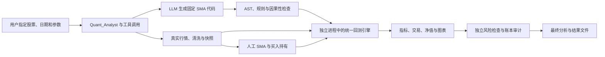

# Finrobot_MFM5110FinalProject_V2

面向 MFM5110 小组项目的 A 股投研与量化实验工具。V2 在组员 1 的 V1 上，补齐了“真实行情 → 参数化回测 → LLM 生成 SMA 代码 → 校验执行 → 风险检查 → 结果留存”的流程，供组员使用和继续开发。

**版本：V2；说明更新：2026-11-19。** 当前主要入口为命令行，量化交互支持 SMA 与买入持有对照。

使用时，你先用自然语言指定股票、日期、均线和资金；程序获取或读取真实行情，运行回测并比较买入持有。你可以继续要求生成同规则 Python 代码、执行代码和检查风险，最后查看分析、交易记录与图表。原有的基本面、市场分析和研究报告角色也保留，具体可用范围见下文。

- [V2 仓库与下载](https://github.com/ohayoo335/Finrobot_MFM5110FinalProject_V2)：使用 Code → Download ZIP，或 `git clone https://github.com/ohayoo335/Finrobot_MFM5110FinalProject_V2.git`。
- [V1 与 V2 对照](#v2-相较-v1-补充了什么) · [当前完整功能](#当前完整功能) · [首次运行六步](#快速开始) · [交互示例](#第-5-步开始对话) · [实验复现](#实验与复现) · [功能边界](#当前边界与未完成项)。
- 开发交接：[项目状态](PROJECT_STATUS.md)、[补全计划](COMPLETION_PLAN.md)、[环境状态](ENVIRONMENT_STATUS.md)。本仓库提供代码、数据与实验记录，课程报告正文尚未编写。

已有项目环境和本地模型 Key 时，在仓库根目录运行：

```powershell
.\run_finrobot.cmd --role Quant_Analyst
```

## V2 相较 V1 补充了什么

V1 来源为[组员 1 分享的项目](https://github.com/yjt2003/Finrobot_MFM5110FinalProject)，本次对照基线为本仓库保留的提交 [`8d2cc02`](https://github.com/ohayoo335/Finrobot_MFM5110FinalProject_V2/commit/8d2cc02dde93053b0a4faeec9efd19ec618ff75a)。以下按该基线与当前 V2 代码比较；V1 上游之后的改动不包含在这个对照中。

| 方面 | V1 已有内容 | V2 的补充或改动 |
| --- | --- | --- |
| 投研角色 | `A_Share_Analyst`、`Market_Analyst`、`Expert_Investor`，以及 AutoGen 角色与工具注册框架 | 沿用原角色，新增 `Quant_Analyst`、量化提示词与 7 个量化工具，专门处理数据、回测、代码执行和风险核查 |
| A 股数据 | `CNStockUtils`、AkShare / Tushare 路由及行情回退接口 | 修复腾讯行情字段与特定 AkShare 版本的成交量口径；新增 OHLCV 清洗、来源与单位记录、真实数据快照及 SHA-256 校验 |
| 回测 | `BackTraderUtils.back_test`，默认使用 Yahoo 行情，支持策略、初始资金、Sizer 等参数 | 增加本地 CSV 入口；新增统一的 A 股信号回测流程，让人工 SMA、买入持有与 LLM SMA 使用同一份数据、费用和执行引擎 |
| LLM 代码生成 | 通用 Agent、编程与执行基础模块 | 新增固定 SMA 任务的代码生成接口、AST 检查、规则一致性与前缀因果性检查、限时子进程执行、错误反馈和修正记录 |
| 风险约束 | 原有角色中的风险分析要求，以及基础回测参数 | 在新回测流程落实只做多、整手、资金与开仓预算约束、佣金及滑点；新增独立账本审计和 `check_quant_risk` 工具 |
| 多轮交互 | 已支持单次提问与保留上下文的 CLI 对话 | 接入用户指定股票、日期、均线、资金和开仓预算；支持继续生成代码、查询风险及切换实验，实验按参数和数据哈希隔离 |
| 实验与证据 | 保留的投资小组、多因子、组合优化等原有实验脚本 | 新增统一实验入口、人工对照、5 次独立生成及失败记录、3 标的 × 3 时段的 45 次冻结代码回放，以及指标、交易、净值和图表 |
| 终端输出 | Agent 调用过程直接显示在控制台 | 默认显示等待提示、本轮最终分析和保存位置；详细过程进入日志，支持 `--verbose`；修复最终答复漏显及误取历史文本的问题 |
| 环境与交接 | 原有依赖表、配置说明和示例 | 新增 Windows / Python 3.11 锁定依赖、根目录启动脚本、离线复验、37 项测试、打包脚本及不含真实 Key 的配置模板 |

V2 的核心进展是把已有投研框架扩展为可交互、可复现、可核对的固定规则量化实验。现有验证覆盖实现正确性与有限案例复用，尚未证明 LLM 能提高投资收益。

## 当前完整功能

### 1. 四个主要角色与原有扩展模块

统一入口为 `run_finrobot.cmd`，通过 `--role` 选择角色；省略问题进入多轮对话，提供问题则执行单次分析。

| 角色 | 当前代码提供的能力 | 验证范围 |
| --- | --- | --- |
| `A_Share_Analyst`（默认） | 查询公司资料、行情、分红、三大财务报表、财务指标、同业比较、历史估值、机构预期、研报、公告与新闻，并调用价格图表工具 | 沿用 V1；已验证初始化和基础模型工作流，完整基本面分析未逐项验收 |
| `Market_Analyst` | 结合区间行情、公司与市场新闻、热度排名、公告及公司背景解释市场表现 | 沿用 V1；已验证初始化，全部数据接口与完整分析流程未逐项验收 |
| `Expert_Investor` | 查询年报链接、财务与机构数据，调用 K 线、股价表现、PE/EPS 图表及 PDF 研究报告工具 | 沿用 V1；已验证初始化，完整 PDF 报告流程尚未验收 |
| `Quant_Analyst` | 按用户参数准备真实数据，比较 SMA 与买入持有，生成并执行同规则 Python 代码，独立检查风险，解释实际回测结果 | V2 新增；已完成真实三轮对话、工具调用与回测数字核对 |

仓库还保留 V1 的通用编程、数据分析等角色，单 Agent、RAG、Shadow 与多 Agent 工作流，FinNLP 数据源、文本/PDF/RAG 工具，以及投资小组、多因子、组合优化等脚本。这些模块可供后续开发，未全部纳入 V2 量化验收；新增量化主流程使用 `SingleAssistant` 与工具调用。

### 2. 真实数据获取、清洗与复用

- A 股数据通过 `CNStockUtils` 获取，可配置 `auto`、`akshare`、`tushare`。`auto` 对支持的接口优先尝试 Tushare，失败后回退 AkShare；新闻、公告及部分财务接口仍走 AkShare。随仓库的配置模板选择 `akshare`，无需 Tushare Token。
- 量化流程统一日期和 OHLCV 字段，排序、去重、去除不完整观测，检查价格与成交量，记录成交量从“手”到“股”的转换；不补造缺失交易日或模拟行情。
- 保存适配器输出、清洗 CSV、实际覆盖日期、来源、复权方式、处理记录和哈希。交互中仅复用标的、复权、覆盖范围、历史预热与哈希均符合要求的数据，否则调用数据层获取真实行情。
- 固定实验、跨标的实验、个人交互实验分别存放；多标的与交互实验按参数及数据哈希区分结果目录，原始固定案例另行保留。

### 3. 策略回测、绩效与独立风险检查

当前已验证的规则是：**收盘 SMA(fast) > SMA(slow) 时目标为持有，否则空仓**，并与买入持有比较。两者使用同一数据和资金费用假设。

- 只做多、持有或空仓；收盘形成的信号最早在下一个有行情的交易日开盘执行。
- 默认初始资金 100,000 元，开仓预算 80%，100 股一手，佣金率 0.03%，最低佣金 5 元，滑点 0.05%；这是实验配置中的简化假设。
- 交互可修改股票、日期、fast/slow、初始资金与开仓预算；费用、整手等参数由实验配置控制。多标的验证另支持自定义配置文件。
- 输出初始/最终资产、总收益率、年化收益率、最大回撤、Sharpe、成交订单数、累计佣金、最低现金，以及每日净值、交易记录、风险事件和对比图。
- `check_quant_risk` 根据成交记录独立重建现金和持股，核对净值、指标、信号与成交先后、整手、资金及开仓预算，并报告实际持仓权重。

`max_position` 是**每次开仓的预算比例**，并非持续硬性仓位上限。持仓后权重会随价格漂移，风险工具会明确报告这一点。多标的及交互实验使用过去数据预热，预热期不交易、不计绩效，第一评价日收盘才形成首个可执行信号。

### 4. LLM 生成代码、校验、运行与修正

Quant_Analyst 或批量实验可让模型生成两个函数：`generate_signals(data, fast, slow)` 与 `run_strategy(data, config)`。生成代码须通过语法白名单、接口检查、固定 SMA 信号一致性、前缀因果性及可信回测引擎结果一致性检查。

执行使用有限时的独立 Python 进程。源码、原始响应、执行结果和错误会保存；交互工具把失败原因返回模型供其修正，批量实验也保留初次失败与后续修正记录。模型生成的是该固定规则的 Python 实现，回测仍由统一引擎完成。

AST 限制和进程超时用于约束此任务，不等同于通用操作系统沙箱。当前尚未支持任意新策略的自由生成、自动择优或参数寻优。

### 5. 可核对的工具调用与结果文件

| Quant_Analyst 工具 | 功能 |
| --- | --- |
| `get_data_summary` | 读取固定 V2 案例的数据摘要与快照哈希 |
| `backtest_reference` | 对固定案例运行人工 SMA 或买入持有 |
| `read_backtest_result` | 读取固定案例已保存的指标与交易结果 |
| `prepare_quant_experiment` | 按用户指定参数准备实验，返回独立 `experiment_id` |
| `compare_quant_strategies` | 对该交互实验运行 SMA / 买入持有并保存指标、净值、交易与图表 |
| `execute_quant_code` | 保存并校验当轮模型代码，执行后回传结果或错误 |
| `check_quant_risk` | 独立审计人工或生成策略，保存风险检查结果 |

用户指定的股票与参数走后四个工具；前三个工具用于已有的固定案例。结果数字来自 Python 工具与保存文件，代码校验会核对生成实现与人工规则。

## 快速开始

第一次使用按下面六步操作；已经装好环境并填好 Key 的组员可直接从[第 5 步](#第-5-步开始对话)开始。命令均在项目根目录的 PowerShell 中运行。

### 第 1 步：下载并进入项目目录

若已从 GitHub 下载 ZIP，先解压，再在解压后的项目文件夹中打开 PowerShell。若使用 Git，运行：

```powershell
git clone https://github.com/ohayoo335/Finrobot_MFM5110FinalProject_V2.git
cd Finrobot_MFM5110FinalProject_V2
```

**这一步完成后：** 当前目录应能同时看到 `README.md`、`setup.py` 和 `run_finrobot.cmd`。ZIP 解压后的文件夹名称可能不同，以里面的文件为准。

### 第 2 步：创建 Python 3.11 环境并安装依赖

已验证环境为 **Windows x64、Python 3.11.16、CPU**，无需独立显卡。先确保本机已安装 Python 3.11，再依次运行：

```powershell
py -3.11 --version
py -3.11 -m venv .venv
.\.venv\Scripts\python.exe -m pip install -r requirements-windows-py311.lock.txt
.\.venv\Scripts\python.exe -m pip install --no-deps --no-build-isolation -e .
.\.venv\Scripts\python.exe -c "import nltk; nltk.download('punkt', download_dir='.cache/nltk_data'); nltk.download('averaged_perceptron_tagger', download_dir='.cache/nltk_data')"
.\.venv\Scripts\python.exe -m pip check
```

**这一步完成后：** 根目录出现 `.venv`，最后一行检查应返回 `No broken requirements found.`。安装依赖和下载 NLTK 数据需要联网；首次安装包含较大的 PDF/RAG 依赖，耗时取决于网络。尚未安装 Python 3.11 时，先完成 Python 安装再执行命令。

项目要求 Python 3.10–3.11，推荐使用上述已验证的 3.11；Python 3.13 不适用。其他系统、依赖版本和可选 uv 安装方式见[环境补充](#环境补充)。

### 第 3 步：先验证本地流程

仓库已包含实验所需的真实数据快照与模型代码。先运行下面的完整离线检查，确认环境、回测和代码执行能正常工作：

```powershell
.\.venv\Scripts\python.exe scripts/validate_v2.py
```

**这一步完成后：** 控制台各项检查的 `ok` 应为 `true`，汇总写入 `artifacts/quant_v2/validation_summary.json`，其中总 `ok` 也应为 `true`。这一步包含 37 项测试、依赖检查、交互工具离线回放、5 份保存代码重跑及多标的评价，本机历史完整运行约 1.5–2 分钟。

这一检查以仓库内保存的实验记录完整为前提，不需要先填写模型 Key，也不进行新的模型对话。只想复现已有实验的组员可以做到这一步，再查看[实验与复现](#实验与复现)；要使用自然语言交互，继续第 4 步。

### 第 4 步：填写本地 API 配置

先从示例复制两个配置文件。下面的命令只在文件不存在时复制，不覆盖已有配置：

```powershell
if (-not (Test-Path finrobot_autogen\OAI_CONFIG_LIST)) { Copy-Item finrobot_autogen\OAI_CONFIG_LIST.example.json finrobot_autogen\OAI_CONFIG_LIST }
if (-not (Test-Path finrobot_autogen\config_api_keys)) { Copy-Item finrobot_autogen\config_api_keys.example.json finrobot_autogen\config_api_keys }
```

| 本地文件 | 如何填写 |
| --- | --- |
| `finrobot_autogen/OAI_CONFIG_LIST` | 把示例中的 `api_key` 占位符替换为自己的模型 Key；默认模型名为 `deepseek-flash`，地址为 `https://api.deepseek.com/v1`，保留模板中的 `extra_body.thinking.type=disabled` |
| `finrobot_autogen/config_api_keys` | 默认可保留空 `TUSHARE_TOKEN` 与 `CN_DATA_PROVIDER=akshare`；有 Tushare Token 时可改为 `auto`，`tushare` 模式用于只调用 Tushare 支持的接口并暴露错误 |

用编辑器打开 `finrobot_autogen/OAI_CONFIG_LIST`，将 `REPLACE_ME_DEEPSEEK_API_KEY` 替换为自己的 Key，保留双引号和其余模板字段并保存。不要把 Key 填进 README 或示例模板。

**这一步完成后：** `finrobot_autogen/` 中应有不带扩展名的 `OAI_CONFIG_LIST` 和 `config_api_keys`，前者已填入有效模型 Key。两个文件都是 JSON，不支持 `#` 或 `//` 注释；实际配置已被 Git 忽略，仓库只分发 `.example.json` 模板。

如需切换模型，在 `OAI_CONFIG_LIST` 中添加或修改服务项，并用 `--model` 选择与配置完全一致的名称。服务须提供本项目可用的 OpenAI 兼容工具调用接口；其他模型尚未逐一验证。详细配置参考[原有配置说明](finrobot_autogen/CONFIG_README.md)，当前 V2 的文件名、默认模型与命令以本 README 为准。

真实 API 请求会产生用量；框架显示的 DeepSeek `cost=0` 不能作为实际计费依据。项目不分发真实 API Key、虚拟环境或缓存。

### 第 5 步：开始对话

第一次先使用量化角色。在根目录运行：

```powershell
.\run_finrobot.cmd --role Quant_Analyst
```

**这一步完成后：** 终端应显示角色 `Quant_Analyst` 和 `你 >` 提示符。启动脚本会自动使用项目 `.venv`、正确工作目录、UTF-8 和本地 NLTK 路径，无需先激活环境。

下面是同一会话的三轮示例。每次输入一句，等本轮分析完成后再输入下一句：

```text
回测000651在2023-2024年的10/30均线，本金10万，开仓预算60%，比较买入持有并检查风险。
继续生成并运行同规则的Python代码，再检查生成策略的风险。
现在换成600031，2025年，20/60均线，开仓预算50%，重新比较并解释结果。
```

第一轮准备数据并完成两种策略对比与风险检查；第二轮沿用该实验生成和执行代码；第三轮切换股票与参数，建立对应实验。模型可能根据当前上下文选择不同调用顺序，实际过程可在日志中核对。

继续提问可沿用当前实验；更改标的、日期或参数会准备对应实验。输入 `exit`、`quit`、`:q` 或 `/exit` 退出。更新代码后须退出旧会话再重启。

### 第 6 步：查看分析与实验结果

默认终端显示“正在分析”、本轮最终分析和分析文件位置。模型请求失败或未产生最终分析时会显示对应状态，避免把用户提问或上一轮全文当作本轮结果；`--verbose` 可显示工具与调试过程。

先打开终端给出的 `.md` 文件阅读本轮分析；要核对收益、交易和图表，再进入对应 `experiment_id` 的结果目录。**这一步完成后：** 应能找到本轮分析文件，以及已执行工具生成的回测、代码或风险文件。

| 输出位置 | 内容 | 是否随仓库提供 |
| --- | --- | --- |
| `data/quant_v2/`、`artifacts/quant_v2/` | 固定案例数据、配置、原始模型输出、生成代码、失败与修正记录、指标、交易、图表和验证摘要 | 是 |
| `data/quant_generalization/`、`artifacts/quant_generalization/` | 多标的快照、预热与评价配置、45 次回放及汇总 | 是 |
| `data/quant_dialogue/<experiment_id>/` | 个人交互实验的数据与参数 | 否，Git 忽略 |
| `artifacts/quant_dialogue/<experiment_id>/` | 个人交互的回测、生成代码、风险检查、事件和图表 | 否，Git 忽略 |
| `artifacts/quant_dialogue/chats/`、`artifacts/agent_chats/` | 每轮最终分析 `.md`、完整历史 `.json`、详细过程 `.log` | 否，Git 忽略 |

启动阶段的依赖警告写入 `.cache/agent_startup.log`。公开材料只保留真实对话的脱敏核对摘要，个人聊天和临时实验留在本地。

### 其他常用启动命令

完成首次运行后，可按需切换角色或打开调试输出：

```powershell
# 默认 A 股基本面角色：单次提问
.\run_finrobot.cmd "分析一下 600519" --role A_Share_Analyst
# 市场分析或研究报告角色
.\run_finrobot.cmd --role Market_Analyst
.\run_finrobot.cmd --role Expert_Investor
# 显式选择模型、数据源并显示详细过程
.\run_finrobot.cmd --role Quant_Analyst --model deepseek-flash --provider akshare --verbose
# 仅查看参数，不调用模型
.\run_finrobot.cmd --help
```

### 首次运行遇到问题

| 现象 | 先检查什么 |
| --- | --- |
| 找不到 `run_finrobot.cmd` 或依赖文件 | 回到第 1 步确认当前目录，命令应在同时包含 `setup.py` 和启动脚本的项目根目录执行 |
| `py -3.11 --version` 失败 | 本机需要先安装 Python 3.11，并确认该命令能找到它；不要直接改用 Python 3.13 |
| 找不到 `OAI_CONFIG_LIST`，或提示模型配置为空 | 检查第 4 步是否复制成功；实际文件名没有扩展名，模型名称应与 `--model` 一致 |
| 模型请求失败或没有最终分析 | 打开本轮提示的 `.log`，或用 `--verbose` 重启；按日志检查 Key、网络或工具错误，不能把旧分析当成本轮结果 |

## 实验与复现

### 固定案例：对照、重复生成与失败记录

配置：[quant_v2_config.json](finrobot_autogen/experiments/quant_v2_config.json)。标的 `000001`，2021–2025 年，1,212 条真实日线，20/60 日均线，初始资金 100,000 元，80% 开仓预算。

| 策略 | 总收益率 | 最大回撤 | Sharpe |
| --- | --- | --- | --- |
| 人工 SMA / 最终通过校验的 LLM SMA | -27.969558% | 35.485943% | -0.392180 |
| 同预算买入持有 | -24.237415% | 58.630890% | -0.100196 |

共完成 **5 次独立代码生成**：4 次 JSON 首次合格且无需模型修正，1 次 JSON 错误经 1 次模型修正后通过；另有 1 次初始执行因校验器过严而失败，修正校验器后原代码通过。因此首次完整执行为 **3/5**，无需模型修正通过为 **4/5**，最终为 **5/5**，不能将最终通过率写成首次成功率。

证据：[生成评估](artifacts/quant_v2/evaluation.json)、[指标对照](artifacts/quant_v2/comparison.csv)、[账本审计](artifacts/quant_v2/audit.json)、[对比图](artifacts/quant_v2/comparison.png)。该案例评价固定规则实现，结果没有显示 LLM 相对人工同规则策略的收益提升。

### 多标的、多时段验证

配置：[generalization_config.json](finrobot_autogen/experiments/generalization_config.json)。标的 `000001`、`000651`、`600031`；三个不重叠评价时段为 2021–2022、2023–2024、2025。每段使用此前 60 条观测预热，重新初始化资金，保持相同策略与费用。

冻结上述 5 份模型代码，在 **9 个标的/时段案例上共回放 45 次，全部与人工同规则结果一致**。这些回放没有新增 LLM 请求，也不是 45 次独立代码生成。SMA 相对买入持有在不同案例有胜有负，结果全部保留。

结果入口：[latest.json](artifacts/quant_generalization/latest.json)；对应运行目录保存 `inputs.json`、`summary.json`、`comparison.csv`、`comparison.png` 及各案例的指标、净值、交易和代码检查记录。

### 已有真实交互验证

已保存的三轮对话依次完成 `000651 / 2023–2024 / 10-30 / 60%` 的回测与风险查询、同实验代码生成执行、切换到 `600031 / 2025 / 20-60 / 50%`。核对内容包括工具调用、用户参数、实验 ID、生成结果和回测数字。

脱敏证据：[三轮工具与结果核对](artifacts/quant_v2/dialogue_online_validation.json)、[终端输出核对](artifacts/quant_v2/console_output_validation.json)。这是已保存的真实验证记录，运行离线命令不会重新进行模型对话。

### 复现命令

完成环境安装后，在仓库根目录运行：

```powershell
# 使用已保存的数据与模型输出，重算传统对照和评估；不产生新的模型请求
.\run_quant_v2.cmd all --resume
# 在独立进程中重新执行保存的 5 份代码；不调用模型
.\run_quant_v2.cmd verify
# 用已保存的真实数据重跑多标的、多时段评价
.\run_generalization.cmd evaluate --resume
# 离线检查交互工具，使用保存的模型代码
.\.venv\Scripts\python.exe scripts/validate_quant_dialogue.py --offline
# 运行现有 37 项离线测试
.\.venv\Scripts\python.exe -m unittest discover -s tests -v
# 完整离线复验：测试、依赖、交互工具、代码重跑、断点续跑与通用性评价
.\.venv\Scripts\python.exe scripts/validate_v2.py
```

上述命令使用仓库内已完成的快照和模型输出，无需模型 Key。`all --resume` 会检查已有生成；如果对应记录缺失或未完成，将进入生成步骤，需要 Key，不能视为任何目录状态下都保证离线的命令。

需要新数据或新模型请求时再运行：

```powershell
# 获取缺失行情并评价；已有快照核对哈希后复用
.\run_generalization.cmd all --resume
# 使用自定义标的、时段配置，生成独立结果目录
.\run_generalization.cmd all --config path\to\my_config.json --resume
# 实际执行三轮模型对话，需要自己的 Key，会产生 API 用量
.\.venv\Scripts\python.exe scripts/validate_quant_dialogue.py --online
```

需要生成新的策略代码时，推荐使用第 5 步的交互入口，每次执行会保留新的生成记录。固定批量入口使用固定的 `generation_XX` 目录：已有执行记录时，不加 `--resume` 会拒绝运行；加 `--resume` 则复用已有结果，不算新的独立生成。新的批量实验应先单独规划结果目录并保留原始证据。

固定案例入口支持 `fetch`、`baseline`、`generate`、`repair`、`verify`、`evaluate`、`all` 和 `--resume`；`--refresh-data` 会重新取数。多标的入口支持 `fetch`、`evaluate`、`all`、`--config` 和 `--resume`。

历史本机测量中，完整离线复验约 1.5–2 分钟，固定案例 `all --resume` 约 9–11 秒，均含依赖导入开销。完整流水线记录见 [validation_summary.json](artifacts/quant_v2/validation_summary.json)，其中测试数是该次记录的 29 项；随后终端修复扩展至 37 项，见终端核对摘要。上述耗时不包含首次安装，也不代表其他机器的运行时间。

## 环境补充

完整版本见 [requirements-windows-py311.lock.txt](requirements-windows-py311.lock.txt)，兼容限制见 [constraints-windows-py311.txt](constraints-windows-py311.txt)。Python 3.10 与其他操作系统的完整安装尚未在 V2 重新验证，Windows 锁定文件含平台专用依赖。

| 主要依赖 | 验证版本 | 用途 |
| --- | --- | --- |
| pyautogen | 0.2.35 | Agent、工具调用与模型接口 |
| openai / httpx | 1.55.3 / 0.27.2 | OpenAI 兼容接口客户端 |
| numpy / pandas | 1.26.4 / 2.0.3 | 数据处理与指标计算 |
| backtrader | 1.9.78.123 | 回测执行 |
| akshare | 1.20.7 | A 股行情及投研数据 |
| matplotlib | 见锁定文件 | 实验图表 |
| torch / onnxruntime | 2.5.1 CPU / 1.19.2 | 保留的 PDF/RAG 依赖所需 Windows 兼容版本 |

本机也已使用 uv 从同一锁定文件安装。已有 uv 的组员可用以下三行替代第 2 步的环境创建和两个安装命令，之后仍需执行 NLTK 下载和 `pip check`：

```powershell
uv venv --python 3.11 --cache-dir .cache/uv .venv
uv pip install --python .venv/Scripts/python.exe --cache-dir .cache/uv -r requirements-windows-py311.lock.txt
uv pip install --python .venv/Scripts/python.exe --cache-dir .cache/uv --no-deps --no-build-isolation -e .
```

## 架构与代码位置



| 位置 | 作用 |
| --- | --- |
| [run_agent.py](finrobot_autogen/run_agent.py) | 单次/多轮 CLI、角色与模型选择、最终分析与日志保存 |
| [agent_library.py](finrobot_autogen/finrobot/agents/agent_library.py)、[prompts.py](finrobot_autogen/finrobot/agents/prompts.py) | 角色、工具注册和实际使用的量化提示词 |
| [data_source/](finrobot_autogen/finrobot/data_source/) | 原有投研数据源、A 股路由与行情兼容修复 |
| [quant_tools.py](finrobot_autogen/finrobot/functional/quant_tools.py) | 固定案例数据清洗、快照与三个工具 |
| [quant_dialogue.py](finrobot_autogen/finrobot/functional/quant_dialogue.py) | 参数化交互实验、对照、独立风险查询与代码执行 |
| [quantitative.py](finrobot_autogen/finrobot/functional/quantitative.py) | Backtrader 回测、费用资金约束、绩效与账本审计 |
| [strategy_codegen.py](finrobot_autogen/finrobot/functional/strategy_codegen.py) | 生成代码的语法、接口、规则与因果性校验 |
| [experiments/](finrobot_autogen/experiments/) | 固定案例与多标的实验配置、批量入口及执行子进程 |
| [tests/](tests/)、[scripts/](scripts/) | 离线测试、完整复验、真实对话验证和开发交接打包 |
| `data/`、`artifacts/` | 数据快照和实验结果；随仓库提供的范围见前文输出表 |

## 当前边界与未完成项

- 已验证的量化能力限于 A 股日线、参数化 SMA 和买入持有。未完成任意策略生成、自动参数搜索、样本外策略选择、多资产组合策略或实盘下单；原有组合优化脚本未纳入这一验收。
- 费用、成交及复权采用明确的简化假设；未完整模拟涨跌停、流动性、印花税、实际现金分红和公司行动。风险检查通过表示符合这些实验约束。
- 9 个案例与 45 次回放只说明固定代码在这些输入上可复用，不能推出任意市场有效或投资收益提升。
- 原有基本面、市场分析、PDF 研究报告、OCR/RAG 与多 Agent 示例未全部端到端验证。OCR/embedding 权重未预下载，环境初次检查未找到 `wkhtmltopdf`；仅安装相关 Python 包不代表 PDF/OCR 功能已经跑通。
- 当前交付为命令行代码与实验材料，网页界面、课程报告正文和文献综述尚未完成。

项目版本标识为 [V2](VERSION)，沿用的 FinRobot Python 包版本为 `0.1.5`，两者分别记录。原有许可与归属信息见 [LICENSE](LICENSE)、[NOTICE](NOTICE) 和 [TRADEMARK_POLICY.md](TRADEMARK_POLICY.md)。组员可按上述命令复现，后续扩展应保留原始失败记录、数据来源与传统对照。
